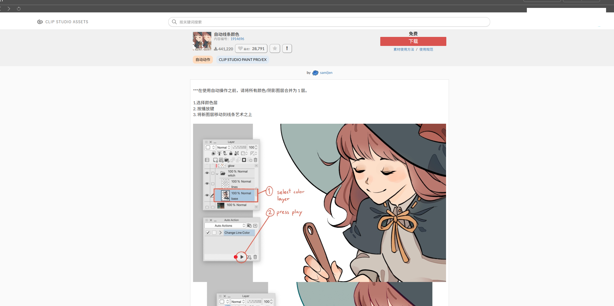

# CLIP STUDIO ASSETS 自动翻译

把 CLIP STUDIO 内置浏览器里的**英文素材页面自动翻译成中文 / 印尼语 / 葡语 / 泰语**。

打开素材库就是目标语言，不用手动点、不用装浏览器扩展。



---

## 为什么需要它

CLIP STUDIO 官方素材站（ASSETS）只服务 **7 种语言**：日、繁中、韩、英、法、德、西。

逐个语言探测的结果：

| 语言路径 | 是否存在 |
|---|---|
| `ja-jp` / `zh-tw` / `ko-kr` / `en-us` / `fr-fr` / `de-de` / `es-es` | ✅ 存在 |
| `zh-cn` / `id-id` / `pt-br` / `th-th` | ❌ 被重定向回 `en-us` |

也就是说，**简体中文、印尼语、葡语、泰语恰好是官方没有的四种** —— 正是本插件支持的四种。

另外要澄清一个常见误解：「官方支持 11 种语言」指的是 **CLIP STUDIO 软件界面**，不是素材站内容，两者是两套机制。

> 官方确实会对用户发布的素材标题/说明做机器翻译（详情页的「View original text」按钮就是原文/译文开关），但只翻成它支持的 7 种语言，质量也是通用机翻水平。

---

## 支持的语言

| 代码 | 语言 | 面板标识 |
|---|---|---|
| `zh-CN` | 简体中文 | 中 |
| `id` | Bahasa Indonesia | ID |
| `pt` | Português | PT |
| `th` | ภาษาไทย | TH |

源语言为英文（接口自动检测）。覆盖两个站点：

- `assets.clip-studio.com` — 素材库
- `start.clip-studio.com` — CLIP STUDIO 首页

---

## 工作原理

CLIP STUDIO 的素材库和首页其实是一个内嵌的 Edge 浏览器（WebView2）。插件做两件事：

1. **给内嵌浏览器打开本地调试端口 9222**
   通过 WebView2 官方的机器级策略实现，**不修改 CLIP STUDIO 的任何文件**
2. **常驻一个 Node 小程序**，发现你打开素材页就通过 CDP 把翻译脚本注入进去

因为 CLIP STUDIO 以管理员权限运行，WebView2 出于安全只接受机器级（HKLM）策略，会忽略环境变量和用户级（HKCU）设置 —— 这就是为什么必须写一条注册表策略。**卸载脚本会把它删干净。**

翻译引擎只改「叶子文本节点」，不碰 `input` 的值、不替换 DOM 结构，所以不会破坏页面的事件和布局。

---

## 翻译质量怎么保证

三层策略，优先用最好的：

| 层级 | 说明 |
|---|---|
| **① 内置词库**（每种语言 152 条） | 界面词人工校对，离线、零延迟、最准 |
| **② 联网机器翻译** | 素材标题/说明走 Google 翻译（失败自动切 MyMemory） |
| **③ 术语纠正** | 把机翻的通用词改成绘画软件惯用语 |

**故意不翻译的内容：**

- 用户名、作者名
- 数字、价格、时间（`10PM`、`340,393`、`50 CP`）
- 本来就是目标语言的内容
- **品牌 / 产品名**（`CLIP STUDIO PAINT`、`PRO/EX`、`Clippy` 等）

> 品牌名保护是必需的：实测机翻会把 `CLIP STUDIO PAINT PRO/EX` 译成印尼语的「KLIP STUDIO CAT PRO/EX」。插件会先把品牌名替换成占位符再送去翻译，回来再还原。

翻译结果按语言分别缓存，翻过的词第二次是瞬间出来的。

---

## 安装

### 前置条件

- Windows 10/11
- CLIP STUDIO / CLIP STUDIO PAINT（任意版本，需自带 WebView2）
- [Node.js](https://nodejs.org) 16 或更高版本（**无需 npm install**，零第三方依赖）

### 步骤

1. 下载或 `git clone` 本仓库
2. **以管理员身份**运行 `install.ps1`：

   ```powershell
   powershell -ExecutionPolicy Bypass -File install.ps1
   ```

   或在文件上右键 →「使用 PowerShell 运行」

3. 重启 CLIP STUDIO，打开素材库即可看到翻译

安装脚本会做三件事：写入 WebView2 策略、注册计划任务、立即启动守护进程。

### 守护进程什么时候运行

**不是随 CLIP STUDIO 启动的**，而是：

| 触发时机 | 说明 |
|---|---|
| **用户登录 Windows 时** | 自动启动，不需要打开 CLIP STUDIO |
| **每 10 分钟** | 自愈检查：进程若被意外结束（崩溃、被任务管理器杀掉），会在 10 分钟内自动恢复 |
| **安装时** | 立即启动一次 |

已在运行时不会重复启动（`MultipleInstances=IgnoreNew`）。

守护进程本身很轻（约 43 MB 内存），平时只是每 2 秒检查一次浏览器页面列表，没打开素材页时几乎不做事。

> 如果不想让它常驻，可以停用计划任务：
> ```powershell
> Stop-ScheduledTask -TaskName "CLIPStudio_翻译守护"
> ```
> 需要时再 `Start-ScheduledTask`，或直接运行 `翻译一次.ps1`。

---

## 使用

装好之后什么都不用做，打开素材库自动翻译。

页面右下角有小圆按钮，数字表示这一页翻了多少处：

| 菜单项 | 作用 |
|---|---|
| **简体中文 / Indonesia / Português / ไทย** | 立即切换目标语言（当前语言高亮） |
| **原文 / Original** | 切回英文原文 |
| **重新翻译本页 / Retranslate** | 强制重扫当前页面 |
| **清空缓存 / Clear cache** | 清掉当前语言的缓存 |

### 切换默认语言

编辑 `config.json`：

```json
{
  "targetLanguage": "zh-CN"
}
```

可选 `zh-CN` / `id` / `pt` / `th`。保存后约 2 秒自动生效，**不用重启**。

> **优先级**：`config.json` 决定默认语言；面板切换只影响当前页面会话。守护进程不会覆盖你的手动选择 —— 只有当你修改了配置文件时才会强制同步所有页面。

---

## 文件结构

```
CLIPStudio-翻译插件/
├─ config.json          ← 默认目标语言
├─ install.ps1          ← 安装
├─ uninstall.ps1        ← 卸载（完全恢复原状）
├─ 翻译一次.ps1         ← 立即翻译当前页
├─ 清空缓存.ps1         ← 清空翻译缓存
├─ README.md
├─ screenshot.png
└─ src/
   ├─ inject.js         ← 注入页面的翻译引擎（核心）
   ├─ daemon.js         ← 守护进程：发现页面并注入
   ├─ cdp.js            ← 极简 CDP 客户端（手写 WebSocket，零依赖）
   ├─ dict.json         ← 四种语言词库
   ├─ common.ps1        ← PowerShell 公共函数（查找 node）
   ├─ clear-cache.js    ← 清缓存实现
   └─ probe.js          ← 调试小工具
```

---

## 自定义词库

编辑 `src/dict.json`，每种语言一个区块：

```json
{
  "zh-CN": { "Pens & Brushes": "钢笔与笔刷" },
  "id":    { "Pens & Brushes": "Pena & Kuas" },
  "pt":    { "Pens & Brushes": "Canetas e pincéis" },
  "th":    { "Pens & Brushes": "ปากกาและพู่กัน" }
}
```

| 字段 | 说明 |
|---|---|
| 语言区块（`zh-CN` 等） | 界面词，命中即直译，不走机器翻译 |
| `postFix` | 机翻结果替换规则，按语言分组 |
| `noTranslate` | 永远不翻译的词 |

品牌名保护在 `inject.js` 的 `BRANDS` 数组里，需要时可在那里加新产品名。

改完保存即可，守护进程会自动发现文件变化并重新注入（刷新页面更快）。

---

## 卸载

以管理员身份运行：

```powershell
powershell -ExecutionPolicy Bypass -File uninstall.ps1
```

会删除注册表策略和计划任务，CLIP STUDIO 完全恢复原样。重启 CLIP STUDIO 后素材库变回英文。

---

## 常见问题

**Q：打开素材库还是英文？**

先确认重启过 CLIP STUDIO。再检查调试端口：

```
http://127.0.0.1:9222/json/version
```

浏览器能打开就说明端口正常。打不开的话，检查计划任务「CLIPStudio_翻译守护」是否在运行。

**Q：翻译有点慢？**

第一次遇到新词要联网翻译，之后走缓存。整页首次大约 3～10 秒。

**Q：会影响 CLIP STUDIO 正常使用吗？**

不会。插件只读写网页内容，不碰程序文件、配置和你的作品。

**Q：CLIP STUDIO 升级后还能用吗？**

策略按进程名（`CLIPStudio.exe`）绑定，升级一般不影响。若失效，重新运行一次 `install.ps1`。

**Q：印尼语和葡语都是拉丁字母，怎么判断哪些已经翻译过？**

两层判断：① 先比对词库里的译文；② 再用该语言的高频功能词做启发式判断（印尼语 `yang/dan/untuk`，葡语 `para/com/não`），命中两个以上即认为已是目标语言。泰语有独立字符区（`\u0E00-\u0E7F`），判断最可靠。

**Q：切换语言后旧译文会残留吗？**

不会。切换时先把页面还原成英文原文，再用新语言重翻。

**Q：为什么左侧导航栏还是中文/英文？**

那是 CLIP STUDIO 的**原生界面**，不属于网页内容，插件管不到。它跟随你软件的界面语言设置。

**Q：安全吗？**

- 不修改 CLIP STUDIO 程序文件
- 不读取你的作品、账号或密码
- 调试端口只监听本机 `127.0.0.1`，不对局域网开放
- 翻译内容会发给 Google 翻译（可在 `inject.js` 里替换成别的接口）

---

## 技术细节

- WebView2 在管理员权限的宿主进程里会忽略 `WEBVIEW2_ADDITIONAL_BROWSER_ARGUMENTS` 环境变量和 HKCU 策略，只接受 HKLM 策略
- 注入通过 CDP 的 `Runtime.evaluate` 完成，`daemon.js` 每 2 秒扫一次页面列表，发现新页面/刷新就重新注入
- `cdp.js` 是手写的 WebSocket 客户端，避免引入 `ws` 依赖
- 用 `MutationObserver` 监听动态加载的素材卡片，滚动加载的内容也会被翻译
- 语言探测结论是通过逐个请求各语言路径、观察是否被重定向得出的

---

## 已知限制

- 只支持 Windows（依赖 PowerShell 计划任务和注册表策略）
- **图片里印的文字**无法翻译（那是图片内容）
- 素材标题/说明依赖机翻，质量取决于 Google
- 左侧原生界面不受影响

---

## 许可

MIT
